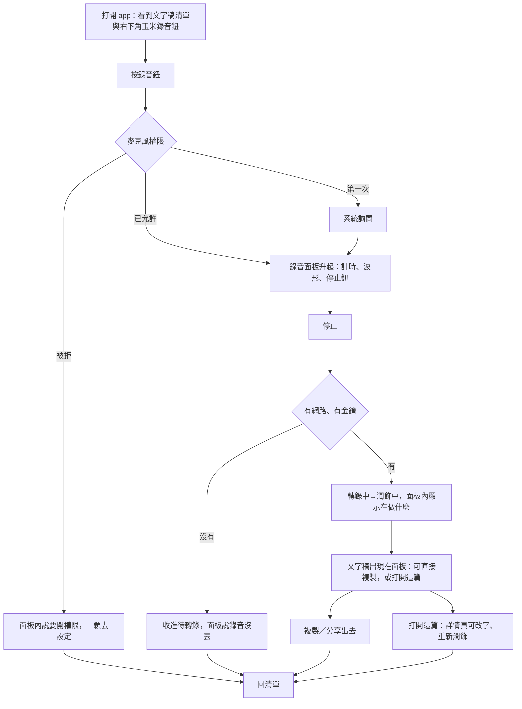

# 流程與資訊架構

**日期**：2026-10-31｜**前提**：`01-核心動作卡-暫定.md`（閘門 1 未過，本檔標「依暫定卡」）
**範圍**：iOS 原生 app「米說」，只做 iPhone 直向。

---

## 一、核心迴圈（從「成功的感覺」倒著畫）

```
⑥ 文字貼進 Threads／Notion／文件 ← 成功的感覺：「這段貼上去就能用了」
⑤ 文字稿在手上（已複製／可分享）
④ 潤飾完成，文字稿出現
③ 停止說話
② 說話（看得到在錄、看得到還在聽）
① 打開 app／按下錄音
```

每一格問「它怎麼幫第⑥格」：

| 格 | 怎麼幫最後那一刻 | 判定 |
|---|---|---|
| ① 打開並開始 | 越短越好。核心動作不依賴金鑰、不依賴網路（錄音可離線） | 留 |
| ② 說話中 | 唯一要回答的是「它還在聽嗎」——波形與計時就是為這句話存在 | 留 |
| ③ 停止 | 一個動作、一個落點 | 留 |
| ④ 潤飾 | 這是等待，不是價值。要誠實說在做什麼、還有多久 | 留 |
| ⑤ 文字稿在手上 | **這格是高峰**。自動複製預設開，一顆「複製」固定在底部 | 留 |
| ⑥ 貼出去 | 系統分享表單＋剪貼簿。app 幫不上更多，所以結尾停在這裡，不追著要評分、不跳付費頁 | 留 |

**被刪掉的格**：
- 「錄完先選要存到哪個資料夾」→ 刪。第一次用的人答不出來（2-2），而且把第⑤格往後推。
- 「錄完先問要不要潤飾」→ 刪。潤飾就是這個 app 的價值，不要做成選項。
- 「開場先看隱私與費用說明」→ 刪成一行，移到第一次真的要上傳時（見 `06-首次體驗.md`）。

## 二、任務路徑（3–5 條，之後直接當測試題）

1. 「你剛想到一段想發的文字，用這個 app 把它變成可以貼出去的字。」
2. 「你上週錄過一段講訂閱制的內容，把它找出來，複製最後一段。」
3. 「這篇文字稿斷句怪怪的，你想用另一個寫法重新整理一次。」
4. 「你在沒有網路的地方錄了一段，回到有網路的地方把它轉成文字。」
5. 「你要換手機了，把文字稿帶走。」



## 三、四條岔路

| 路徑 | 第一次 | 沒有內容 | 失敗 | 被打斷 |
|---|---|---|---|---|
| 1 說一段變文字 | 沒金鑰也能錄；錄完收進待轉錄並說清楚（不擋錄音） | 清單是空的 → 邀請句＋指向錄音鈕的空狀態 | 沒網路／金鑰錯／API 回錯：第一句先說「錄音還在待轉錄」 | 來電、鎖屏、切 app：**錄音繼續**（背景音訊）；app 被系統結束 → 回來時待轉錄有那一段，不是零 |
| 2 找舊的那一段 | 清單只有一筆，搜尋還沒用處 | 搜不到 → 「沒有包含『xxx』的文字稿」＋清除關鍵字 | 載入失敗 → 顯示舊清單＋可關閉的橫幅（不是整頁錯誤） | 切走再回來：搜尋字與捲動位置還在 |
| 3 重新潤飾 | 第一次按「重新潤飾」要先知道會覆寫什麼 | 口語稿是空的 → 不顯示這顆按鈕 | 潤飾失敗 → 舊文字稿**一字不動**，錯誤只出現在工具列上方 | 潤飾中被切走：回來後顯示結果或「失敗，舊的還在」 |
| 4 離線補轉 | — | 待轉錄是空的 → 這個區塊整個不出現 | 連上網也失敗 → 檔案留著，可單獨重試，可刪（刪要確認） | 轉一半斷線 → 已成功的段落保留，只重試失敗段 |
| 5 帶走資料 | — | 沒東西可匯出 → 按鈕變灰並說為什麼 | 匯出失敗 → 說哪一步失敗、原檔沒事 | — |

「使用者自己按取消」**不是失敗**，不跳任何訊息（2-8）。

## 四、進入點

| 進入點 | 落在哪個畫面 | 怎麼回主線 |
|---|---|---|
| 主畫面圖示 | 文字稿清單（首頁） | 已在主線 |
| 通知「文字稿好了」 | 首頁＋自動打開那一篇的詳情頁 | 返回手勢回首頁 |
| 靈動島／鎖定畫面的錄音中狀態 | 錄音面板（已在錄的那一段） | 停止後走正常流程 |
| 捷徑／Siri「用米說錄一段」 | 直接進錄音面板並**開始錄**（不停在首頁） | 停止後回首頁，那一篇在最上面 |
| 動作按鈕（iPhone 15 Pro 以後） | 同捷徑 | 同上 |
| 控制中心／鎖定畫面小工具 | 同捷徑 | 同上 |
| 分享表單（從語音備忘錄分享音檔進來） | 首頁的待轉錄，並開始轉 | 轉完進詳情頁 |
| Spotlight 搜文字稿內容 | 該篇詳情頁 | 返回手勢回首頁 |
| 不做的進入點 | 不做深層連結網址、不做 Handoff、不做桌面小工具的「顯示最新文字稿」（文字稿是隱私內容，不放在桌面上） | — |

⚠️ 捷徑、動作按鈕、靈動島（Live Activity）、小工具、背景音訊的**實作條件與審核要求會變**，寫程式前要查證（書的查證日期 2026-10）。

## 五、畫面清單

| 畫面 | 結構 | 唯一主角 | 從哪來 | 回哪去 | 要處理的狀態 |
|---|---|---|---|---|---|
| **首頁：文字稿清單** | 根（不做分頁列，見下方理由） | 右下角的錄音鈕 | 圖示、通知、返回 | — | 第一次／空／載入／載入失敗但有舊資料／有待轉錄／沒金鑰 |
| **錄音面板** | 模態（半頁，不可下滑關閉） | 計時與波形（「它還在聽」） | 首頁錄音鈕、捷徑、動作按鈕 | 收起回首頁 | 準備中／錄音中／轉錄中／潤飾中／完成／失敗／權限被拒／被打斷回來 |
| **文字稿詳情** | 推入（堆疊） | 文字稿正文 | 首頁點一列、完成後「打開這篇」、通知 | 返回手勢或左上返回鈕 → 首頁 | 有文字稿／只有口語稿／編輯中／潤飾中／潤飾失敗 |
| **穀倉** | 推入（堆疊） | 收成的玉米 | 首頁導覽列穀倉鈕、首頁「本週收成」方塊 | 返回 → 首頁 | 第一次（0 根）／有收成 |
| **設定** | 推入（堆疊） | 金鑰那一列 | 首頁「⋯」選單 | 返回 → 首頁 | 沒金鑰／金鑰驗證中／金鑰有效／金鑰無效 |
| **匯出／分享** | 系統分享表單（模態） | 系統的 | 詳情頁分享鈕、設定頁匯出 | 自動關閉 | 成功／取消（取消不報錯） |
| **刪除確認** | 系統動作表 | 「刪除」那一項 | 詳情頁「⋯」 | 刪完回首頁 | — |

**為什麼不做分頁列**：主要的「地方」只有一個（文字稿清單），穀倉與設定是偶爾去的，錄音是**動作**不是地方（2-5：分頁放地方，不放動作）。做了分頁列會多一層空殼，而且會把錄音鈕從拇指最好按的位置擠走。這條照 2-5 失效邊界 2「只有一兩個主要畫面不做分頁列」。
**修正上一輪的建議**：`審查紀錄.md` #1 我建議過底部分頁列，那是針對舊版 Flutter 介面「主要去處藏在無文字圖示裡」的問題。改成這個結構（首頁本身就是歷史、錄音鈕常駐底部、穀倉與設定用推入頁）同樣解掉那個問題，而且少一層，所以本檔不採分頁列。

## 六、結構樹（純文字，給人測）

```
米說
├─ 文字稿清單（首頁）
│  ├─ 搜尋
│  ├─ 本週收成
│  ├─ 待轉錄
│  │  └─ 轉錄這一個／刪掉這一個
│  └─ 某一篇文字稿
│     ├─ 文字稿
│     ├─ 口語稿
│     ├─ 複製
│     ├─ 分享
│     ├─ 重新潤飾
│     └─ 刪除
├─ 錄音
├─ 穀倉
│  ├─ 收成
│  ├─ 錄音時間
│  └─ 連續錄音天數
└─ 更多
   ├─ 匯入音檔
   ├─ 匯出全部文字稿
   └─ 設定
      ├─ OpenAI 金鑰
      ├─ 潤飾（模型、自訂詞彙、提示詞）
      ├─ 使用習慣（自動複製、文字大小、外觀）
      ├─ 資料（匯出備份、匯入備份）
      └─ 關於
```

### 樹狀測試包

- **題目**：直接用第二節的五條任務句。
- **做法**：印出這棵樹，每一層用紙蓋住。請他用手指點，點了才掀開下一層。不解說、不提示。
- **測試者**：沒看過這個 app 的人，一輪 3 人；要宣布通過時換新的 5 人。
- **記錄表**：

| 受測者 | 題目 | 第一下點哪 | 完整路徑 | 有沒有退回 | 最後停在哪 | 成功 Y/N | 直接 Y/N | 他說了什麼 |
|---|---|---|---|---|---|---|---|---|

- **我猜會掉的題**（猜測，不是結論）：題 5「把文字稿帶走」會有人先點「匯出全部文字稿」、有人先點「設定 → 資料 → 匯出備份」——同一件事兩個入口兩個名字，這是標籤問題，等測試結果再動。

### 樹狀測試結果

**待測。** 成功率、直接度、第幾輪、改了什麼、重測結果都還沒有。本檔的結構沒有經過任何沒看過的人。

## 七、完成判準（米逐條回過／不過）

- [ ] 每條任務路徑都畫了第一次、沒內容、失敗、被打斷 → 已畫（第三節）
- [ ] 每個進入點都知道落在哪、怎麼回主線 → 已列（第四節）
- [ ] 每個畫面寫得出唯一主角、結構、從哪來、回哪去 → 已列（第五節）
- [ ] 結構樹給沒看過的人測過，記下成功率與直接度 → **待測**
- [ ] 測試後改過的地方換新的人重測 → **待測**

後兩條沒做完，這一步不算完成；下游的線框標「依未測結構」。
